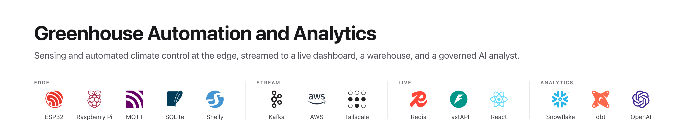
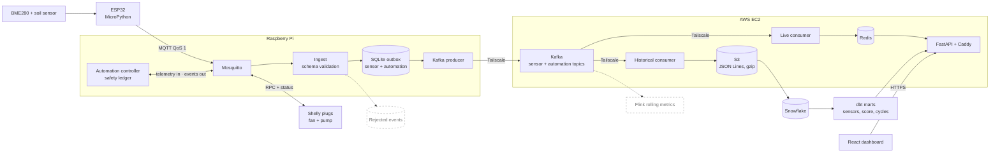

<p align="center">
  
</p>

<p align="center">
  
  
  
  
  
  
  
  
  
  
  
  
  
  
  
</p>

# Greenhouse IoT Streaming Pipeline

An end-to-end streaming pipeline and local automation system for a greenhouse. An ESP32 publishes temperature, humidity, pressure, and soil-moisture readings over MQTT to a Raspberry Pi, which validates and buffers them in SQLite before forwarding them to Kafka on AWS. The same Pi runs a controller that switches a fan and an irrigation pump (Shelly smart plugs) from those readings and publishes every action as an event. Live consumers feed Redis for a React dashboard; a historical consumer archives both streams to S3, and tested dbt models in Snowflake power analytics for sensors, a conditions score, and actuator cycles.

**Live:** [Dashboard](https://greenhouse.gregoryjoshua.com) · [API health](https://api.gregoryjoshua.com/health)

## Architecture



Solid boxes are implemented. Dashed boxes are on the [roadmap](#roadmap). Details: [Architecture](docs/architecture.md).

## Data flow

1. The ESP32 publishes one JSON event per measurement over MQTT (QoS 1) to Mosquitto on the Pi.
2. The Pi validates each event against its schema, commits it to SQLite, and only then acknowledges the MQTT message.
3. A producer sends pending rows to Kafka and marks a row delivered only after Kafka acknowledges it.
4. The automation controller reads the same telemetry, commands the Shelly plugs, and publishes actuator events on a second MQTT topic. They take the same path (ingest, SQLite, Kafka) on their own topic.
5. The live consumer keeps the latest reading per sensor, the last 10 raw readings per sensor, and the 10 most recent automation events in Redis.
6. The historical consumer batches both Kafka topics into gzip JSON Lines objects in S3 and commits only after the upload. Malformed messages are quarantined in S3 rather than blocking the stream.
7. Snowflake tasks load S3 into `RAW`; dbt deduplicates on `event_id` and builds staging, intermediate, and mart models.
8. FastAPI serves live data from Redis and history from Snowflake marts. The dashboard polls the API.

Delivery is at-least-once, with deduplication by `event_id`.

## Features

### Automation

[`gateway/automation.py`](gateway/automation.py) runs on the Pi as `greenhouse-automation.service`.

| Actuator | Rule |
| --- | --- |
| Fan | On at 24 °C or above, off at 21 °C or below (hysteresis) |
| Pump | Runs 6 s when calibrated soil moisture is below 40 % for 3 consecutive fresh readings |

The pump is guarded by a persistent SQLite ledger (112-minute cooldown, at most 8 runs per day, budget reserved *before* the ON command), stale-data and plausibility checks, a watchdog that forces OFF on unexpected or overlong runs, and QoS 0 for `Switch.Set` so a reconnect cannot replay a pump start. Actuator events (`command_issued`, `command_acknowledged`, `command_failed`, `state_changed`) go through a durable outbox and are archived like sensor data. Shelly plugs must also be configured with power-restore OFF and a device-side auto-off limit; software alone cannot protect against an offline plug.

### Soil moisture calibration

The sensor's raw capacitance is noisy, so the calibrated value is the percentage of the last 10 raw readings at or above 990 (`wet-like` at 40 % or more, otherwise `dry-like`). Raw readings stay unchanged in events and the archive. The Pi controller, the live API, and the dbt models each apply the same transform.

### Conditions score

A versioned, rules-based **0–100** suitability score (`conditions-v2`) from air temperature, relative humidity, and calibrated soil moisture. It measures alignment with configured growing targets, **not** verified plant health. Live scores come from Redis via FastAPI; historical scores come from dbt hourly and daily marts. Rules live in [`config/environmental_score.v1.json`](config/environmental_score.v1.json) and feed both the Python scorer and the dbt seed. Methodology: [Environmental Conditions Score](docs/environmental-conditions-score.md).

### Dashboard

| Page | Contents |
| --- | --- |
| Home | Live score, one card per sensor (calibrated moisture with state), recent fan and pump cycles; polls every 3–5 s and marks readings older than 30 s stale |
| Analytics | Score history, sensor series, and automation overlays (sensor series with pump or fan cycles marked) for `24h` / `7d` / `30d` |
| Control, AI analyst | Placeholders; manual overrides and the analyst are not wired up yet |
| About | Project overview |

Warehouse data is refreshed on a schedule, so history can lag live data. See [API reference](docs/api.md) for endpoints.

## What this demonstrates

- **Durable edge buffering.** SQLite outbox with acknowledge-after-commit ingestion, surviving Kafka and network outages.
- **Safe actuation.** Local control loop with a persistent safety ledger, uncertain-outcome handling, watchdog shutoff, and an at-least-once event outbox.
- **Delivery semantics.** Persistent MQTT QoS 1, idempotent Kafka producer, manual offset commits, Redis timestamp guard.
- **Versioned data contracts.** JSON Schemas for sensor (v1, v2) and automation (v1) events, validated at the gateway.
- **Replayable streaming.** Two Kafka topics, two consumer groups: live Redis view and durable S3 archive with quarantine.
- **Warehouse analytics.** S3 → Snowflake → dbt marts → FastAPI: sensor series, conditions score, actuator cycles.
- **Operations and CI/CD.** systemd, Compose, pytest, dashboard lint/test/build, Tailscale/SSH deploys on `main`, scheduled dbt.
- **Decision records.** [ADRs](docs/decisions/README.md) for the main design choices.

## Roadmap

- **Control.** Dashboard manual overrides and a governed AI analyst (placeholders today).
- **Reliability.** Rejected-event store on the gateway; retention for the automation outbox; gateway input hardening.
- **Security.** TLS for MQTT and Kafka; tighter MQTT ACLs.
- **Observability.** External alerting, consumer-lag metrics, end-to-end synthetic probe; Flink rolling metrics.
- **Score and sensors.** Crop-specific profiles (bump `score_version`); additional sensors such as light or CO₂.
- **Infrastructure as code.** Terraform for hosts and DNS; deploy verification and rollback in CI.

## Documentation

| Document | Contents |
| --- | --- |
| [Architecture](docs/architecture.md) | Components, event flow, data stores, delivery guarantees |
| [API reference](docs/api.md) | Live, automation, history, and score endpoints |
| [Environmental Conditions Score](docs/environmental-conditions-score.md) | Scoring methodology, calibration, limitations |
| [Snowflake setup](docs/snowflake-setup.md) | Warehouse bootstrap, S3 load tasks, roles, JWT users |
| [Data contracts](docs/data-contracts.md) | Sensor and automation schemas, validation, safe evolution |
| [Adding a sensor](docs/adding-a-sensor.md) | Step-by-step guide and checklist |
| [Deployment](docs/deployment.md) | CI/CD, setup, updates, verification, and rollback |
| [Operations](docs/operations.md) | Health checks, logs, troubleshooting |
| [Decision records](docs/decisions/README.md) | ADRs for the main design choices |
| [ESP32 firmware](firmware/esp32/README.md) | Hardware, MicroPython flashing, wiring, configuration |
| [Infrastructure](infrastructure/README.md) | Component-level infrastructure notes |
| [Warehouse (dbt)](warehouse/README.md) | Models, tests, score seed |
| [Dashboard](dashboard/README.md) | Pages, hooks, configuration, commands |

Configuration templates: [`.env.example`](.env.example), [`firmware/esp32/config.example.py`](firmware/esp32/config.example.py). Schemas: [`schemas/`](schemas/).

## Repository layout

```text
firmware/esp32/       MicroPython sensor firmware
sensor_simulator/     Synthetic MQTT event generator
gateway/              Pi ingest, producer, automation controller, cleanup, health
schemas/              Versioned sensor and automation event schemas
consumers/live/       Kafka to Redis consumer (latest, history, automation events)
consumers/historical/ Kafka to S3 archive consumer (both topics, quarantine)
api/                  FastAPI service (Redis live data, Snowflake history)
config/               Versioned environmental score rules (JSON)
warehouse/            dbt project (staging, intermediate, marts, score seed)
dashboard/            React / Vite dashboard (Home, Control, Analytics, About)
infrastructure/       systemd, Mosquitto, Kafka, Caddy config and scripts
tests/                pytest suites (schemas, gateway, automation, consumers, API)
.github/workflows/    CI and deployment workflow
requirements/         Dependencies per deployment role
compose.yaml          Consumers, Redis, and API containers
docs/                 Architecture, API, scoring, Snowflake, operations (+ assets/)
```
