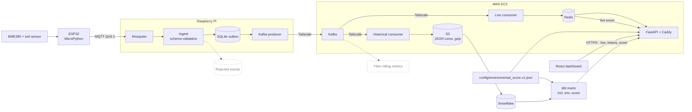

<p align="center">
  
</p>

<p align="center">
  
  
  
  
  
  
  
  
  
  
  
  
  
  
  
</p>

# Greenhouse IoT Streaming Pipeline

An end-to-end streaming pipeline for greenhouse temperature, humidity, atmospheric pressure, and soil moisture. Sensors on an ESP32 publish readings over MQTT to a Raspberry Pi, which validates and buffers them in SQLite before forwarding them to Kafka on AWS. A live consumer keeps the latest values in Redis for a React dashboard served by FastAPI. A historical consumer archives every event to S3; tested dbt models in Snowflake power analytics for raw readings and a calcutated conditions score, and summarize by hour and day.

**Live:** [Dashboard](https://greenhouse.gregoryjoshua.com) · [API health](https://api.gregoryjoshua.com/health)

## Architecture



Solid boxes are implemented. Dashed boxes are on the [roadmap](#roadmap). Details: [Architecture](docs/architecture.md).

## Data flow

1. The ESP32 reads the sensors and publishes one JSON event per measurement over MQTT (QoS 1) to Mosquitto on the Pi.
2. The Pi validates each event against its schema version, commits it to SQLite, and only then acknowledges the MQTT message.
3. A producer sends pending rows to Kafka and marks a row delivered only after Kafka acknowledges it.
4. The live consumer updates the latest reading per sensor and measurement in Redis, committing its Kafka offset after the write.
5. The historical consumer, in its own consumer group, batches events into gzip-compressed JSON Lines objects in S3 and commits only after the upload succeeds.
6. A Snowflake task loads new S3 objects into `RAW.SENSOR_EVENTS`. dbt builds staging, intermediate, and mart models (including environmental scores) with `event_id` deduplication.
7. FastAPI serves live readings and the live conditions score from Redis, plus historical sensor series and score history from Snowflake marts. The React dashboard shows Live and History views.

Delivery is at-least-once, with deduplication by `event_id`.

## Analytics

### Environmental Conditions Score

The primary analytics product is a versioned, rules-based **0–100** suitability score (`conditions-v1`) from air temperature, relative humidity, and soil moisture. It measures alignment with configured growing-environment targets — **not** verified plant health.

| Path | Computation |
| --- | --- |
| Live | FastAPI scores the latest Redis readings for a gateway (`GET /api/v1/environment/score/current`) |
| Historical | dbt hourly/daily score marts in Snowflake; FastAPI reads them (`GET /api/v1/environment/score/history`) |

Shared rules live in [`config/environmental_score.v1.json`](config/environmental_score.v1.json) and feed both the Python scorer and the dbt seed. The Live dashboard leads with the score; History charts score trends (or individual sensors).

Methodology: [Environmental Conditions Score](docs/environmental-conditions-score.md) · Warehouse bootstrap: [Snowflake setup](docs/snowflake-setup.md) · API shapes: [API reference](docs/api.md)

### Historical sensor series

Hourly and daily aggregates for each sensor and measurement (`GET /api/v1/history/series`, periods `24h` / `7d` / `30d`). The History tab plots averages with min–max bands and weighted period summaries from warehouse marts. Loads and dbt runs are scheduled; charts can lag live data.

### Live readings

`GET /api/v1/sensors/latest` from Redis. The Live tab polls every 3 seconds and marks readings older than 30 seconds as stale. Individual cards stay available even if the score endpoint is incomplete or down.

## What this demonstrates

- **Durable edge buffering.** SQLite outbox with acknowledge-after-commit ingestion through Kafka and network outages.
- **Delivery semantics.** Persistent MQTT QoS 1, idempotent Kafka producer, manual offset commits, Redis timestamp guard.
- **Versioned data contracts.** JSON Schema v1 and v2 at the gateway.
- **Replayable streaming.** Dual Kafka consumer groups: live Redis view and durable S3 archive.
- **Warehouse analytics.** S3 → Snowflake task → dbt marts → FastAPI, including the Environmental Conditions Score.
- **Operations and CI/CD.** systemd, Compose, pytest, dashboard lint/test/build, Tailscale/SSH deploys on `main`, scheduled dbt.
- **Decision records.** [ADRs](docs/decisions/README.md) for the main design choices.

## Roadmap

- **Reliability.** Rejected-event / DLQ path; historical consumer quarantine for bad Kafka messages; gateway input hardening.
- **Security.** TLS for MQTT and Kafka; tighter MQTT ACLs.
- **Observability.** External alerting, consumer-lag metrics, end-to-end synthetic probe.
- **Score and sensors.** Calibrate soil moisture and crop-specific profiles (bump `score_version`); optional new measurement types (e.g. light, CO₂).
- **Infrastructure as code.** Terraform for hosts/DNS; deploy verification and rollback in CI.

## Documentation

| Document | Contents |
| --- | --- |
| [Architecture](docs/architecture.md) | Components, event flow, data stores, delivery guarantees |
| [API reference](docs/api.md) | Live, history, and environmental-score endpoints |
| [Environmental Conditions Score](docs/environmental-conditions-score.md) | Scoring methodology, inputs, limitations |
| [Snowflake setup](docs/snowflake-setup.md) | Warehouse bootstrap, S3 load task, roles, JWT users |
| [Data contracts](docs/data-contracts.md) | Schemas, validation points, safe schema evolution |
| [Adding a sensor](docs/adding-a-sensor.md) | Step-by-step guide and checklist |
| [Deployment](docs/deployment.md) | CI/CD, setup, updates, verification, and rollback |
| [Operations](docs/operations.md) | Health checks, logs, troubleshooting |
| [Decision records](docs/decisions/README.md) | ADRs for the main design choices |
| [ESP32 firmware](firmware/esp32/README.md) | Hardware, MicroPython flashing, wiring, configuration |
| [Infrastructure](infrastructure/README.md) | Component-level infrastructure notes |
| [Warehouse (dbt)](warehouse/README.md) | Staging, intermediate, score marts, seed generation |

Configuration templates: [`.env.example`](.env.example), [`firmware/esp32/config.example.py`](firmware/esp32/config.example.py). Schemas: [`schemas/`](schemas/).

## Repository layout

```text
firmware/esp32/      MicroPython sensor firmware
sensor_simulator/    Synthetic MQTT event generator
gateway/             Raspberry Pi ingest, producer, cleanup, health, migrations
schemas/             Versioned event schemas and examples
consumers/live/      Kafka to Redis consumer
consumers/historical/ Kafka to S3 archive consumer
api/                 FastAPI service (live Redis + Snowflake history/scores)
config/              Versioned environmental score rules (JSON)
warehouse/           dbt project (staging, intermediate, marts, score seed)
dashboard/           React / Vite dashboard (Live + History tabs)
infrastructure/      systemd, Mosquitto, Kafka, Caddy config and scripts
tests/               pytest suites (schemas, gateway, consumer, API)
.github/workflows/   CI and deployment workflow
requirements/        Dependencies per deployment role
compose.yaml         Consumers, Redis, and API containers
docs/                Architecture, API, scoring, Snowflake, operations (+ assets/)
```
