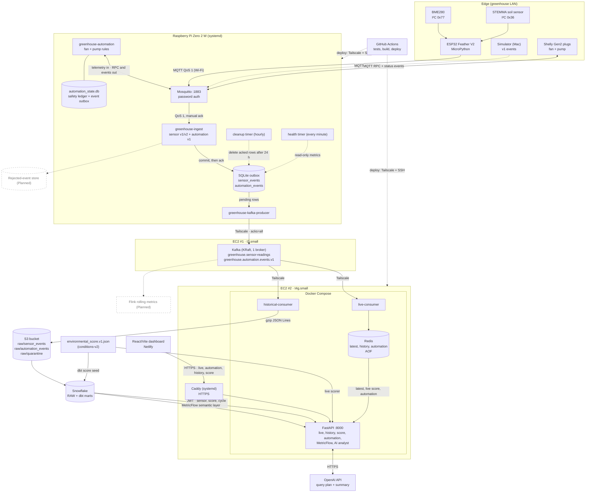

# Architecture

How the pipeline is built and why. This document describes how the implementation works. Planned work is tracked in the [roadmap](../README.md#roadmap).

Related documents: [Data contracts](data-contracts.md) · [Adding a sensor](adding-a-sensor.md) · [Deployment](deployment.md) · [Operations](operations.md) · [ADRs](decisions/README.md)

## System overview

Solid boxes are implemented. Dashed boxes are planned (see the [roadmap](../README.md#roadmap)). Dotted arrows are side channels (cleanup, health, deployment), not event flow.

## Components

| Component | Responsibility | Runs on | Status | Code |
| --- | --- | --- | --- | --- |
| ESP32 firmware | Read sensors, build schema v2 events (one per measurement), sync time via NTP, publish with MQTT QoS 1 | ESP32 Feather V2 (MicroPython) | Implemented. Each sensor initializes, reads, and recovers independently | [`firmware/esp32/`](../firmware/esp32/) |
| Simulator | Generate synthetic schema v1 events (3 per second; reads `MQTT_TOPIC`) | Mac | Implemented. Validates against schema v1; uses `sim-` prefixed gateway and sensor IDs so simulated events are distinguishable from real ones (see [Deployment](deployment.md#simulator)) | [`sensor_simulator/simulate.py`](../sensor_simulator/simulate.py) |
| Mosquitto | MQTT broker; password authentication, plain TCP on 1883 | Pi | Implemented | [`infrastructure/mosquitto/greenhouse.conf`](../infrastructure/mosquitto/greenhouse.conf) |
| Ingest | Subscribe to the sensor and automation MQTT topics, validate sensor events against v1/v2 and automation events against v1, insert into the matching SQLite outbox table, then acknowledge | Pi, systemd | Implemented | [`gateway/ingest.py`](../gateway/ingest.py) |
| SQLite outbox | Durable buffer between MQTT and Kafka: tables `sensor_events` and `automation_events` | Pi | Implemented | `gateway/data/sensor_events.db` (git-ignored) |
| Kafka producer | Publish pending rows from both outbox tables to their Kafka topics (one batch per stream per pass); mark rows only after broker acknowledgment | Pi, systemd | Implemented | [`gateway/kafka_producer.py`](../gateway/kafka_producer.py) |
| Automation controller | Read telemetry, drive Shelly fan and pump plugs over MQTT RPC, enforce pump safety limits, publish actuator events | Pi, systemd | Implemented, tested | [`gateway/automation.py`](../gateway/automation.py) |
| Automation state | Pump-attempt ledger (cooldown and daily budget) and durable automation-event outbox, separate from the ingest database | Pi | Implemented | `gateway/data/automation_state.db` (git-ignored) |
| Shelly Gen2 plugs | Fan and pump relays, controlled with `Switch.Set` / `Switch.GetStatus` over MQTT; must be set to power-restore OFF with a device-side auto-off | Greenhouse LAN | In use; configured on the devices | n/a |
| Cleanup | Delete Kafka-acknowledged rows older than 24 h | Pi, systemd timer | Implemented, tested | [`gateway/cleanup.py`](../gateway/cleanup.py) |
| Health check | Emit JSON status (backlog, freshness, disk); exit 0/1/2 | Pi, systemd timer | Implemented, tested | [`gateway/health.py`](../gateway/health.py) |
| Kafka broker | Single-node KRaft broker; topics `greenhouse.sensor-readings` and `greenhouse.automation.events.v1` | EC2 #1, systemd | Implemented | [`infrastructure/kafka/greenhouse.properties.example`](../infrastructure/kafka/greenhouse.properties.example), [`infrastructure/systemd/kafka_EC2/kafka.service`](../infrastructure/systemd/kafka_EC2/kafka.service) |
| Live consumer | Consume both topics; maintain latest value and the last 10 raw readings per sensor/measurement, and the 10 most recent automation events, in Redis | EC2 #2, Docker Compose | Implemented | [`consumers/live/consumer.py`](../consumers/live/consumer.py) |
| Redis | Latest-state, recent-history, and recent-automation materialized views | EC2 #2, Docker Compose | Implemented | [`compose.yaml`](../compose.yaml) |
| Historical consumer | Consume both topics in its own group, batch events per partition, upload gzip JSON Lines to S3, commit after upload; quarantine malformed messages | EC2 #2, Docker Compose | Implemented | [`consumers/historical/consumer.py`](../consumers/historical/consumer.py) |
| S3 bucket | Durable raw archive of every event | AWS | In use; bucket and IAM are configured outside this repo | n/a |
| FastAPI | Read-only HTTP API: live readings (with calibrated soil moisture), live score, and recent automation events from Redis; sensor series, score history, and automation history from Snowflake; governed metric queries and the AI analyst | EC2 #2, Docker Compose | Implemented | [`api/`](../api/), [`config/`](../config/) |
| MetricFlow adapter | Validate metric and dimension names against MetricFlow's catalog, run `mf query` (no shell) against the dbt semantic layer, compile SQL with `--explain` | EC2 #2, inside the API container | Implemented | [`api/services/metricflow.py`](../api/services/metricflow.py), [`api/routes/metrics.py`](../api/routes/metrics.py) |
| AI analyst | Ask OpenAI for a structured query plan, validate it against an approved catalog, run it through MetricFlow, summarize only the returned rows, return chart-ready data and the compiled SQL | EC2 #2, inside the API container | Implemented | [`api/services/analyst.py`](../api/services/analyst.py), [`api/analyst_catalog.json`](../api/analyst_catalog.json) |
| Caddy | HTTPS reverse proxy to `127.0.0.1:8000` | EC2 #2, systemd | Implemented | [`infrastructure/caddy/caddyfile`](../infrastructure/caddy/caddyfile) |
| Dashboard | Home (live score, readings, analyst shortcut, recent automations), Analytics (AI analyst workspace; score, sensor, automation history), Control placeholder, About | Netlify | Implemented | [`dashboard/`](../dashboard/) |
| Tailscale | Private network between Pi, Kafka host, and serving host; CI also joins it to reach the deploy targets | Pi, both EC2 hosts, CI runners | In use | n/a |
| GitHub Actions | Run tests and the dashboard build; on `main`, deploy the Pi gateway services and the serving containers | GitHub-hosted runners | Implemented | [`.github/workflows/ci-cd.yml`](../.github/workflows/ci-cd.yml) |
| Tests | pytest suites for schemas, ingest, automation, the dual-stream producer, cleanup, health, both consumers, and the API; dashboard unit tests | CI and local | Implemented | [`tests/`](../tests/) |
| Rejected-event storage | Persist invalid payloads and errors | Pi | Planned | n/a |
| Flink | Event-time rolling metrics | TBD | Planned | n/a |
| Snowflake | Warehouse: raw sensor and automation events loaded from S3, queried by the API | Snowflake (cloud) | In use; account, load, and IAM are outside this repo | n/a |
| dbt | Staging, intermediate, sensor, score, and automation marts over the raw Snowflake tables, plus a MetricFlow semantic layer (38 reportable metrics) | Local / CI or host with profiles | Implemented | [`warehouse/`](../warehouse/), [Semantic layer](../warehouse/docs/semantic_layer.md) |
| Score config | Versioned environmental suitability rules (`conditions-v2`) shared by the live Python scorer and the dbt seed | Repo + API image | Implemented | [`config/environmental_score.v1.json`](../config/environmental_score.v1.json) |

## Event flow

1. **Sample.** Every `SAMPLE_INTERVAL_SECONDS` (default 5), `main.py` calls `sensors.read_all(devices)`. Each sensor is read independently: the BME280 yields three measurements and the soil sensor one. A sensor that is missing or fails a read is skipped and re-initialized every `SENSOR_RETRY_SECONDS` (30) while the others keep publishing. `main.py` stamps the measurements with one UTC timestamp, a random UUIDv4 `event_id`, `gateway_id`, and `schema_version: 2`.
2. **Publish.** Each measurement becomes its own JSON message on topic `greenhouse/telemetry`, published QoS 1. `umqtt.simple` blocks until the broker's PUBACK; the event is dropped from the in-RAM list only after that. If Wi-Fi, NTP, or MQTT fails, the loop disconnects, schedules a retry in 5 s, and resumes without restarting the program.
3. **Ingest.** `ingest.py` holds a persistent MQTT session (`clean_session=False`, client id `pi-sqlite-ingestor`, QoS 1 subscriptions, `manual_ack=True`) on two topics: `MQTT_SENSOR_TOPIC` (default `greenhouse/telemetry`) and `MQTT_AUTOMATION_TOPIC` (default `greenhouse/automation/events`). The topic selects the event kind. For each message it parses JSON, picks the schema by kind and `schema_version`, and validates.
4. **Persist, then acknowledge.** `INSERT OR IGNORE` into `sensor_events` or `automation_events` (`event_id` primary key, `synchronous=FULL`). The MQTT ack is sent only after the transaction commits. Invalid messages are logged, acknowledged, and dropped.
5. **Produce.** `kafka_producer.py` loops over both outbox tables. For each it reads up to `KAFKA_BATCH_SIZE` (default 100) rows where `kafka_published_at IS NULL`, ordered by `received_at, event_id`, sends them to that stream's topic (`KAFKA_TOPIC` or `KAFKA_AUTOMATION_TOPIC`) with key `event_id` and the stored JSON as the value, waits for every delivery callback, then sets `kafka_published_at` for acknowledged rows only. One batch per stream per pass keeps a sensor backlog from starving automation events. It does not start a new batch while the previous one has unresolved messages.
6. **Consume (live).** `consumers/live/consumer.py` subscribes to both topics.
   - *Sensor events* are checked for the fields the live view needs, then an atomic Lua script updates the Redis hash `greenhouse:latest:{gateway_id}:{sensor_id}:{measurement_type}` unless the stored `timestamp_ms` is newer. When the update applies, the event is also pushed to the capped list `greenhouse:history:{gateway_id}:{sensor_id}:{measurement_type}` (10 most recent), which feeds soil-moisture calibration.
   - *Automation events* are validated (schema version, actuator, event type, timezone-aware timestamp) and pushed to the capped list `greenhouse:automation:recent` (10 events) by a Lua script that skips duplicate `event_id`s.

   Malformed events are logged and skipped. The Kafka offset is committed synchronously after Redis responds.
7. **Archive.** `consumers/historical/consumer.py` reads both topics in group `greenhouse-historical`. It buffers events per topic and partition and flushes when a batch reaches `HISTORICAL_BATCH_SIZE` (240) events or is `HISTORICAL_FLUSH_SECONDS` (300) old. A batch becomes one gzip-compressed JSON Lines object at `s3://$S3_BUCKET/<prefix>/year=YYYY/month=MM/day=DD/<topic>/partition=N/offsets-<first>-<last>.jsonl.gz`, where the prefix is `S3_PREFIX` (`raw/sensor_events`) or `S3_AUTOMATION_PREFIX` (`raw/automation_events`); each line is the original event plus `_kafka_topic`, `_kafka_partition`, and `_kafka_offset`. The Kafka offset is committed synchronously only after `put_object` returns. A message that fails validation is first stored under `S3_QUARANTINE_PREFIX` (`raw/quarantine/<topic>/partition=N/offset-<n>.json`, with the base64 payload and error), after which its offset is committed. On SIGTERM it flushes pending batches before closing.
8. **Warehouse.** Objects in S3 are loaded into Snowflake `GREENHOUSE_ANALYTICS.RAW.SENSOR_EVENTS` and `RAW.AUTOMATION_EVENTS`. The dbt project in [`warehouse/`](../warehouse/) deduplicates on `event_id` and builds `INT_SENSOR_READINGS` (with a rolling calibrated soil-moisture value), `FCT_SENSOR_HOURLY`, `FCT_SENSOR_DAILY`, `FCT_ENVIRONMENTAL_SCORE_HOURLY`, `FCT_ENVIRONMENTAL_SCORE_DAILY`, `FCT_AUTOMATION_EVENTS`, and `FCT_ACTUATOR_CYCLES` (schema names from the dbt profile; the API defaults to `GREENHOUSE_DBT_MARTS`). Score rules are seeded from [`config/environmental_score.v1.json`](../config/environmental_score.v1.json).
9. **Serve (live).** `GET /api/v1/sensors/latest` scans `greenhouse:latest:*` and returns `{count, readings[]}`; each reading carries `raw_value`, and soil moisture adds `calibrated_pct` and `state` computed from the last 10 raw readings in `greenhouse:history:*`. `GET /api/v1/environment/score/current` scores the latest Redis readings for one `gateway_id` in-process, using calibrated soil moisture. `GET /api/v1/automation/events/recent` returns the Redis automation list. `GET /health` pings Redis only.
10. **Serve (history).** `GET /api/v1/history/series`, `GET /api/v1/environment/score/history`, and `GET /api/v1/history/automations` query Snowflake for `period` `24h`, `7d`, or `30d` (hourly or daily grain). The automation endpoint returns a sensor series from `INT_SENSOR_READINGS` (calibrated soil moisture for the pump, air temperature for the fan) plus actuator cycles from `FCT_ACTUATOR_CYCLES`. The API opens a JWT connection with the RSA key mounted at `/run/secrets/snowflake_api_key.pem` ([`api/repositories/snowflake.py`](../api/repositories/snowflake.py)).
11. **Analyze.** `POST /api/analyst/query` sends the question, today's UTC date, and the approved catalog ([`api/analyst_catalog.json`](../api/analyst_catalog.json)) to OpenAI, which returns a structured plan (metrics, dimensions, dates, limit, chart type). The plan is rejected unless every name is in the catalog and compatible, the window is at most 366 days, and no date is in the future. The approved query goes to `POST /api/metrics/query` on loopback, which re-validates it against MetricFlow's catalog and runs `mf query` against the semantic layer in Snowflake. `mf query --explain` compiles the same query to SQL. A second OpenAI call summarizes only the returned rows. The model never writes SQL and never connects to Snowflake.
12. **Display.** The dashboard **Home** page polls `sensors/latest` every 3 s, the score, and recent automation events every 5 s. A reading is stale when its event timestamp is more than 30 s old. **Analytics** opens with the AI analyst workspace (answer, chart, notes, optional SQL), then charts score trends, sensor series, or an automation overlay (series with pump or fan cycles marked). Gateways and sensors for selectors are discovered from the live payload.

### Automation loop

The automation controller runs beside ingest on the Pi and is independent of the Kafka path: it keeps working during WAN outages.

1. **Observe.** It subscribes to telemetry, to its own RPC response topic, and to each Shelly device's status events. Telemetry is accepted only if it is fresh (`MAX_READING_AGE` 90 s, source timestamp required for moisture), finite, in range, and not a duplicate `event_id`.
2. **Decide.** The fan uses hysteresis (on at 24 °C, off at 21 °C). For the pump, a rolling window of the last 10 raw moisture readings is transformed to calibrated percent. The pump starts only after 3 consecutive calibrated readings below 40 %, with the pump observed OFF, no cycle in flight, and budget available (112-minute cooldown, at most 8 runs per 24 h).
3. **Act.** `Switch.Set` is sent at QoS 0 so a reconnect cannot replay a pump start. The pump command includes `toggle_after` (6 s). The attempt is written to the ledger in `automation_state.db` **before** the command is sent, so an uncertain send still consumes budget.
4. **Verify and fail safe.** Relay state is confirmed by `Switch.GetStatus` polls (every 10 s) and device notifications. An RPC timeout is reported as `command_failed` with `rpc_timeout_outcome_unknown` and is never retried for the pump. A pump that is on without an active cycle, or beyond its runtime plus grace, gets an emergency OFF.
5. **Record.** Each command, acknowledgment, failure, and observed state change becomes an automation event (schema v1) written to a durable outbox in `automation_state.db` and published at QoS 1 to `MQTT_AUTOMATION_TOPIC`; a row is deleted only after the broker's PUBACK. Ingest then handles it like any other event.

Background tasks on the Pi run independently of this flow: `greenhouse-cleanup.timer` (hourly) and `greenhouse-health.timer` (every minute).

## Communication and dependencies

| From | To | Protocol | Auth / transport | Notes |
| --- | --- | --- | --- | --- |
| ESP32 | Mosquitto | MQTT 3.1.1, port 1883 | Username/password, no TLS | Uses the Pi's LAN address |
| Ingest | Mosquitto | MQTT 3.1.1, `localhost:1883` | Username/password from `.env` | Always `localhost`; port and topics default to 1883, `greenhouse/telemetry`, and `greenhouse/automation/events`, overridable in `.env` |
| Automation controller | Mosquitto | MQTT 3.1.1, `MQTT_HOST` (default `localhost`) | Username/password from `.env` | Client id `pi-greenhouse-controller`, clean session. Subscribes to telemetry and Shelly topics; publishes RPC and automation events |
| Shelly plugs | Mosquitto | MQTT (Shelly Gen2 RPC) | Configured on the devices | Topics `<SHELLY_*_ID>/rpc` and `<SHELLY_*_ID>/events/rpc` |
| Producer | Kafka | Kafka protocol, `PLAINTEXT`, port 9092 | Tailscale network | `acks=all`, idempotent producer; both topics |
| Live consumer | Kafka | Kafka protocol, `PLAINTEXT` | Tailscale network | Group `LIVE_KAFKA_CONSUMER_GROUP`; subscribes to both topics; manual offset commits |
| Historical consumer | Kafka | Kafka protocol, `PLAINTEXT` | Tailscale network | Group `HISTORICAL_KAFKA_CONSUMER_GROUP`; subscribes to both topics; manual offset commits |
| Historical consumer | S3 | HTTPS | AWS credentials from the EC2 instance profile | Region `AWS_REGION` |
| Consumer, API | Redis | Redis protocol, port 6379 | Internal Docker network only | Redis publishes no host port |
| API | Snowflake | HTTPS / Snowflake protocol | JWT (`SNOWFLAKE_JWT`) with RSA key from a host path mounted into the container | Key path and passphrase from `.env`; connection opened on demand |
| API (MetricFlow) | Snowflake | `mf` CLI via dbt-snowflake | dbt profile mounted read-only at `/app/.dbt` | Runs queries and compiles SQL over the semantic layer |
| API (analyst) | OpenAI | HTTPS | `OPENAI_API_KEY` from `.env` | Two calls per question (plan, summary); `store=False`; 45 s timeout, one retry |
| API (analyst) | API (metrics) | HTTP, loopback | Optional bearer token (`METRICS_API_TOKEN`) | `METRICS_API_URL`, default `http://127.0.0.1:8000/api/metrics/query` |
| Caddy | FastAPI | HTTP | `127.0.0.1:8000` | Compose binds the API to loopback |
| GitHub Actions | Pi, serving host | SSH over Tailscale | Ephemeral Tailscale node tagged `tag:ci`; deploy keys | `main` only, after tests pass |
| Dashboard | Caddy | HTTPS | Public; CORS allow-list on the API | API origin from `VITE_API_URL` / `VITE_API_BASE_URL`, default production host ([`dashboard/src/api/config.js`](../dashboard/src/api/config.js)) |

Startup dependencies: ingest requires `mosquitto.service`. The producer expects network and `tailscaled`. In Compose, the consumer and API wait for Redis to be healthy; the Kafka client reconnects on its own.

Each hop is decoupled by a durable or restartable boundary: SQLite absorbs Kafka and WAN outages (the automation controller needs neither), Kafka absorbs consumer outages, and Redis can be rebuilt from Kafka. The API does not talk to Kafka.

## What is stored where

| Store | Contents | Purpose | Lifetime |
| --- | --- | --- | --- |
| SQLite `sensor_events` (Pi) | One row per accepted event: `event_id` (PK), `event_json`, `received_at` (Pi UTC), `kafka_published_at` (NULL until Kafka acknowledges) | Outbox. Accepts events while Kafka or the WAN is down, and deduplicates by `event_id` | Pending rows are kept indefinitely. Acknowledged rows are deleted after 24 h. This is not a history store |
| SQLite `automation_events` (Pi, same file) | Same outbox shape plus `timestamp_utc`, `actuator`, `event_type`, `command_id`, `cycle_id` | Outbox for actuator events | Pending and acknowledged rows are kept; the cleanup job does not yet touch this table |
| SQLite `automation_state.db` (Pi) | `pump_attempts` (cycle id, attempt time, run seconds) and `event_outbox` (events awaiting MQTT PUBACK) | Pump cooldown and daily budget that survive restarts; durable automation-event publication | Attempts older than 24 h stop counting but are not pruned; outbox rows are deleted on PUBACK |
| Kafka topic `greenhouse.sensor-readings` (EC2 #1) | Full event JSON as value, `event_id` as key. One partition, replication factor 1 | Decouples producer from consumers; allows replay and additional consumer groups | 168 h by `log.retention.hours` in the template |
| Kafka topic `greenhouse.automation.events.v1` | Automation event JSON, `event_id` as key | Same, for actuator events | Broker defaults (168 h) |
| S3 `raw/sensor_events/`, `raw/automation_events/` | One `.jsonl.gz` object per flushed batch, partitioned by UTC date, topic, and partition, named by offset range. Lines are full events plus Kafka lineage fields | Permanent raw archive and source for the Snowflake loads. Duplicates are possible across objects | Governed by the bucket's lifecycle rules, not by this repo |
| S3 `raw/quarantine/` | One JSON object per malformed Kafka message: topic, partition, offset, error, base64 payload | Keeps bad messages out of the archive without blocking it | Same as above |
| Snowflake `RAW.SENSOR_EVENTS`, `RAW.AUTOMATION_EVENTS` | Parsed event fields plus Kafka lineage and load metadata | Warehouse landing tables for dbt | Retention managed in Snowflake |
| Snowflake dbt marts | Hourly and daily aggregates (`FCT_SENSOR_HOURLY`, `FCT_SENSOR_DAILY`, `FCT_ENVIRONMENTAL_SCORE_*`, quality marts) and automation facts (`FCT_AUTOMATION_EVENTS`, `FCT_ACTUATOR_CYCLES`) | Analytics grain for history, score, and automation APIs | Rebuilt by scheduled `dbt build` |
| Redis (EC2 #2) | `greenhouse:latest:{gateway}:{sensor}:{type}` hashes (`value`, `unit`, `timestamp`, `timestamp_ms`, `event_id`, `sensor_id`, `gateway_id`, `measurement_type`); `greenhouse:history:{gateway}:{sensor}:{type}` lists of the 10 newest events; `greenhouse:automation:recent` list of the 10 newest automation events | Low-latency live views for the API, including soil-moisture calibration. Derived data, rebuildable from Kafka | AOF persistence on a Docker volume (`redis_data`). Keys have no TTL; a retired sensor's keys are deleted manually |

SQLite indexes live in [`gateway/migrations/002_outbox_indexes.sql`](../gateway/migrations/002_outbox_indexes.sql). The migration is applied by hand (see [Deployment](deployment.md#database-migration)).

## Delivery guarantees

Delivery is **at-least-once** from the Pi's SQLite commit onward. Duplicates are expected and handled by `event_id`.

| Hop | Acknowledgment | Failure behavior |
| --- | --- | --- |
| ESP32 → Mosquitto | QoS 1 PUBACK from the broker | The event stays in a RAM list and is retried after reconnect. Sampling resumes once the connection is back; the device holds at most one sampling cycle (≤ 4 events) |
| Mosquitto → ingest | Manual ack after SQLite commit | If ingest is down, Mosquitto queues for the persistent session. If the process dies after commit but before the ack, the message is redelivered and ignored as a duplicate |
| Ingest → SQLite | `synchronous=FULL`, ack after commit | A SQLite error is logged and re-raised, which terminates the process. systemd restarts it, and the unacknowledged message is redelivered |
| SQLite → Kafka | Per-message delivery callback, `acks=all`, idempotent producer | Failed or unconfirmed rows stay pending and are retried (`KAFKA_RETRY_SECONDS`, default 5). `delivery.timeout.ms` defaults to 60 000 ms |
| Kafka → Redis | Offset committed after the Redis write | A Redis error terminates the consumer. Docker restarts it and the uncommitted message is reprocessed |
| Kafka → S3 | Offset committed after `put_object` succeeds, per batch | An S3 error terminates the consumer; Docker restarts it and the batch is re-read and re-uploaded, possibly under a different object key |
| Automation controller → MQTT | Event stored in the `event_outbox`, deleted after the broker's PUBACK | Unacknowledged events are republished every 8 s (30 s PUBACK timeout) until acknowledged; ingest deduplicates by `event_id` |
| Controller → Shelly | `Switch.Set` at QoS 0 plus status polling | Outcome is verified from relay status, not assumed. A timeout is recorded as unknown and not retried for the pump; the safety ledger already counted the attempt |

**Duplicates.** Duplicates are possible at the ESP32 (a publish succeeds but the ack is lost), in Kafka (the producer crashes after delivery but before the `kafka_published_at` update; Kafka does not deduplicate by key), and at the consumer (redelivery after a crash). Current handling:

- SQLite deduplicates by `event_id` (`INSERT OR IGNORE`).
- Redis writes are idempotent: an update is skipped only when the stored `timestamp_ms` is strictly newer, so replays cannot regress state. Automation events are deduplicated by `event_id` in Redis.
- Kafka keeps duplicates. The historical path can re-upload a batch after a crash. dbt staging deduplicates on `event_id`; Flink and other aggregators must do the same.

**Ordering.** Kafka order is arrival order at the Pi, not event time. After an outage, the backlog drains oldest-first. Redis keeps the greatest event timestamp, so the dashboard converges to the newest reading.

**Clock dependence.** The Redis guard compares event timestamps, so the newest timestamp for a key wins. The firmware publishes only after the clock is synchronized (year 2025 or later).

**Invalid data.** Ingest logs and drops invalid events; the live consumer logs and skips malformed events; the historical consumer quarantines them in S3 before skipping. See [Data contracts](data-contracts.md#how-invalid-events-are-handled).

## Failure handling summary

| Failure | Effect | Recovery |
| --- | --- | --- |
| Wi-Fi, NTP, or the Pi unreachable from ESP32 | Sampling pauses while disconnected | Automatic reconnect, retried every 5 s without restarting the program |
| A sensor is missing or fails a read | Its measurements are skipped; other sensors keep publishing | The sensor is re-initialized every 30 s |
| Ingest service down | Mosquitto queues messages for its persistent session | systemd `Restart=on-failure` |
| Kafka or Tailscale down | Rows accumulate as pending in SQLite; health check warns at 60 s of backlog age and goes critical at 300 s | Automatic, producer retries every 5 s |
| Consumer or Redis down | Kafka retains events; offsets stay uncommitted | Docker `restart: unless-stopped`, then the consumer resumes from its committed offset |
| S3 unreachable or credentials invalid | Historical consumer exits; Kafka retains events | Docker restarts it; the pending batch is replayed from the last committed offset |
| Malformed Kafka message | Live consumer skips it; historical consumer quarantines it to S3, then skips it | Inspect `raw/quarantine/` |
| MQTT broker or Shelly plug unreachable | The controller cannot command or confirm relays; actuation pauses. Events queue in the durable outbox | Controller reconnects automatically; the pump is only started when relay state is confirmed OFF. Configure a device-side auto-off on the plug as the last line of defense |
| Controller restart | In-memory readings and the moisture window reset, so no pump run can start until a fresh window of 10 readings and 3 low readings arrives. Cooldown and daily budget persist | systemd `Restart=always`, `RestartSec=5` |
| Snowflake unreachable, bad key, or missing marts | Live API stays up; history, score-history, and automation-history endpoints return 503 | Fix key mount/permissions, account settings, or run dbt; see [Operations](operations.md#historical-api-and-snowflake) |
| MetricFlow or OpenAI unavailable | Live and history endpoints are unaffected; metrics queries return 503 and the analyst returns an error the dashboard shows inline | Check the dbt profile mount, `mf` in the image, and `OPENAI_API_KEY`; see [Operations](operations.md#ai-analyst-and-metricflow) |
| Redis data lost | Dashboard empty or partial | Replay from Kafka with a new consumer group, or reset offsets ([Operations](operations.md#4-kafka-has-events-but-redis-is-empty)) |
| Kafka broker restarts | Producers retry; the Pi buffers in SQLite; the consumer reconnects | systemd `Restart=on-failure`, `RestartSec=10` |

Diagnostic procedures: [Operations](operations.md).

## Planned components

Rejected-event storage and Flink rolling metrics are planned, as are dashboard manual controls (a placeholder in the UI), analyst conversation memory, and an automation-impact model for cause-and-effect questions. The automation controller and its event stream, the S3 archive with quarantine, the Snowflake loads, dbt marts (sensors, scores, actuator cycles), the MetricFlow semantic layer, the history, score, automation, metrics, and analyst APIs, and the dashboard Home and Analytics pages (including the AI analyst) are implemented. The roadmap lives in the root [README](../README.md#roadmap).

## CI/CD

[`.github/workflows/ci-cd.yml`](../.github/workflows/ci-cd.yml) runs the pytest suite (with a Redis service) and the dashboard lint, unit tests, and build on every push and pull request. On a push to `main`, once both pass, two jobs deploy over Tailscale and SSH: one restarts the Pi's ingest, producer, and automation services, the other rebuilds the `live-consumer`, `historical-consumer`, and `api` containers. Details are in [Deployment](deployment.md#continuous-integration-and-deployment).

## Implementation notes

- **Schema registry.** Gateway schemas are loaded from `schemas/` at process start into `SENSOR_SCHEMAS` (`{1, 2}`) and `AUTOMATION_SCHEMAS` (`{1}`) in `ingest.py`. A new version is a code change and an ingest restart.
- **Version-agnostic downstream.** The producer forwards stored JSON verbatim. The live consumer checks seven fields on sensor events (five on automation events) and ignores measurement type and unit. The live API and dashboard pass unknown measurement types through. Historical marts aggregate by `measurement_type` without a code change for new types that already exist in the warehouse. This is why most new sensors need no live-path changes ([Adding a sensor](adding-a-sensor.md#what-needs-to-change)).
- **Gateway identity.** The ESP32 sets `gateway_id` from its own `config.py`. `health.py` uses `pi-001`.
- **Snowflake credentials.** Compose mounts `SNOWFLAKE_KEY_HOST_PATH` into the API container at `/run/secrets/snowflake_api_key.pem` and sets `SNOWFLAKE_PRIVATE_KEY_PATH` to that path. The host PEM must be readable by the container user (`appuser`). See [Snowflake setup](snowflake-setup.md).
- **dbt project in the API image.** The API Dockerfile also copies [`warehouse/`](../warehouse/) and installs `requirements/dbt.txt` (dbt-snowflake and dbt-metricflow) so `mf` can run inside the container. Compose mounts the host's `~/.dbt` read-only at `/app/.dbt` for `profiles.yml`. The semantic manifest is whatever was copied into the image, so semantic YAML changes need an API rebuild.
- **Score config in the API image.** The API Dockerfile copies [`config/`](../config/) so live scoring can load `environmental_score.v1.json` (version `conditions-v2`; the filename keeps `v1`) at runtime.
- **Soil-moisture calibration lives in three places.** The Pi controller and the API share the same Python transform (percent of the last 10 raw readings at or above 990); dbt reimplements it as a 10-row window in `int_sensor_readings`. Change all three together, and bump `score_version` when thresholds change. Raw capacitance is never altered in events or S3.
- **Tests.** `tests/` covers the schemas, ingest, cleanup, health, the automation controller (pump gating, safety OFF, durable outbox, uncertain commands), the dual-stream Kafka producer, both consumers (offset-commit ordering, the Redis timestamp guard, S3 upload-before-commit, quarantine), and the API (including history routing with Snowflake mocked and environmental score unit tests). The consumer and live API tests need a Redis instance (`TEST_REDIS_URL`).
